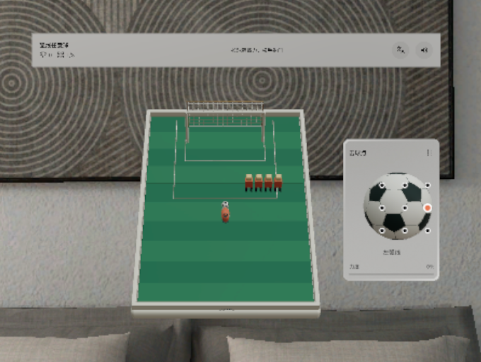
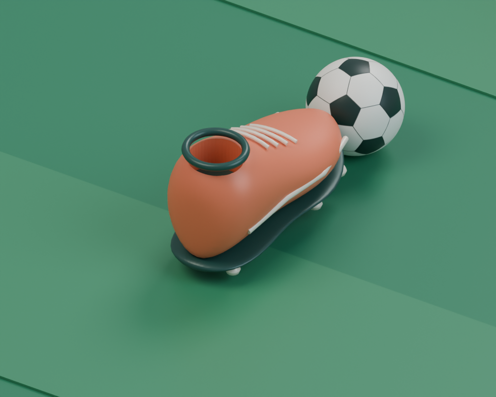

# Free Kicks | 任意球射门

[English](README.md) · [下载 release APK](https://github.com/kejing-dev/free-kicks/releases/latest)

适用于 PICO shared space 的轻量手势游戏。





## 玩法

- 后拉球鞋蓄力，松手射门；70mm 拉动对应满力度。
- 在常开的侧栏 3D 足球上选择九个击球点之一，立即生效。
- 八个关卡通过发球位置和人墙位置形成不同挑战，进球自动进入下一关。
- 拖动侧栏标题移动面板；顶栏提供中英切换和静音图标。
- 圆润球鞋、窄弧形鞋底，抓取体积为 64×80×64mm。

## 构建

使用 JDK 21、Android SDK platform 35 和仓库中的 Gradle wrapper。项目保持 PICO Spatial SDK / SpatialUI **6.1.9**，使用 Kotlin 与 Noto Sans SC。

```sh
./gradlew testDebugUnitTest assembleDebug
./gradlew assembleRelease
```

Windows 下使用 `gradlew.bat`。通过 `ANDROID_HOME` 或未跟踪的 `local.properties` 配置 Android SDK。
需要签名时在本地设置 `ARCADE_KEYSTORE_PATH`、`ARCADE_KEYSTORE_PASSWORD`、`ARCADE_KEY_ALIAS`、`ARCADE_KEY_PASSWORD`；缺省时生成未签名的 release APK。密钥与密码不提交到仓库。

发布附件是关闭调试标记、使用专用发行密钥签名的 release APK。签名与此前开发版不同，不能直接覆盖旧 debug 安装；替换开发版前请自行备份需要的数据。

## 源码与验证

`app/src/main` 为 Kotlin 应用及当前游戏的运行资源，`models` 为 Blender 源模型。模拟库及回归测试延续四应用原型的共享实现，因此源码保留未启用的游戏分支；本仓库只构建当前应用，不打包其他应用的模型或音乐媒体。

构建、测试、签名和 APK 校验见 [验证记录](docs/VALIDATION.md)。截图来自已验证开发基线的原生运行画面，不代表真实手势验收。真实手部追踪、主观音效、双目舒适度和长时性能仍需设备测试。

## 资源说明

仓库含原创 GLB / Blender 游戏模型；Noto Sans SC 遵循 [SIL OFL](licenses/NotoSansSC-OFL.txt)。PICO SDK 与 Android 依赖分别遵循其许可。签名密钥、设备标识和完整开发对话不放入应用仓库。

[Retained regression score attribution / 回归数据曲谱来源](licenses/music-scores.md)
